# Doctor Tracker: Frontend

> **Live app:** https://doctor-tracker-web-eight.vercel.app (mirror: https://doctor-tracker-web.netlify.app) · **API repo:** [doctor-tracker-api](https://github.com/MohammadSiam/doctor-tracker-api) · **Live API docs:** https://doctor-tracker-api-gz8w.onrender.com/api/docs
>
> **Demo login:** `admin@doctortracker.com` / `Admin@123` (there's also a one-click "Use" button on the login page)

## Description

Doctor Tracker is a secure admin portal for clinics and hospital groups to manage doctors and the patients assigned to them. Admins can add doctors, attach patients to them, and search, filter and paginate both lists instantly. The dashboard shows the hospital's state at a glance: total doctors and patients, critical cases, admissions over time, patients per doctor, and the mix by condition, specialty and age. The frontend is a Next.js 16 app that talks to a separate Express + MongoDB REST API. It focuses on a clean, responsive UX in light and dark mode, URL-driven list state, and data fetching that keeps the UI fast even with thousands of records.

## Features

- **Authentication**: httpOnly JWT cookie, route protection in `proxy.ts`, automatic redirect when a session expires, and a safe `?from=` return path after login
- **Doctors**: create, edit, delete; search by name, email, hospital or phone; filter by specialization, hospital and joined-date range; sortable columns; pagination
- **Doctor detail**: profile, their patients (with their own search, filter and pagination), add a patient under the doctor, remove a patient from the list
- **Patients**: list all, edit (including reassigning to another doctor), delete; search; filter by condition, gender, doctor and admission-date range
- **Dashboard**: KPI cards with month-over-month growth, admissions area chart (7D/30D/90D/12M), condition donut, patients per doctor (click a bar to open the doctor), patients by specialization, age distribution, gender split
- **UX details**: skeleton loaders, a thin progress bar while pages change (previous rows stay visible), empty and error states with retry, toast feedback, server validation errors shown on the right form field, confirm dialogs, keyboard-accessible menus, dark mode, and a responsive layout down to 360px

## Tech stack

| Concern | Choice |
|---|---|
| Framework | Next.js 16 (App Router, Turbopack, Cache Components / Partial Prerendering) + React 19 + TypeScript |
| Styling / UI | Tailwind CSS v4, shadcn/ui (Radix primitives), lucide icons |
| Server state | TanStack Query v5 |
| URL state | nuqs (type-safe search params) |
| Forms | react-hook-form + zod (same rules as the API) |
| Charts | Recharts via shadcn chart components |

## Setup guide

**Prerequisites:** Node.js ≥ 20, pnpm (`corepack enable`), and the [API](https://github.com/MohammadSiam/doctor-tracker-api) running locally (default `http://localhost:5000`).

```bash
# 1. Clone and install
git clone https://github.com/MohammadSiam/doctor-tracker-web.git
cd doctor-tracker-web
pnpm install

# 2. Configure the environment
cp .env.example .env.local
#    API_URL=http://localhost:5000   <- where the Express API runs

# 3. Start the dev server
pnpm dev            # http://localhost:3000

# Production build
pnpm build && pnpm start
```

| Variable | Description |
|---|---|
| `API_URL` | Base URL of the Express API. Used **server-side only** by the `/api/*` rewrite in `next.config.ts`, so it never reaches the browser bundle. |

**Deploying to Vercel:** import the repo, set `API_URL` to the Render URL of the API (`https://doctor-tracker-api-gz8w.onrender.com`), and deploy. No other configuration is needed.

**Netlify mirror:** the same app also runs on Netlify (`netlify.toml`), with the same `API_URL` variable, because `*.vercel.app` is unreachable from some networks.

## System architecture

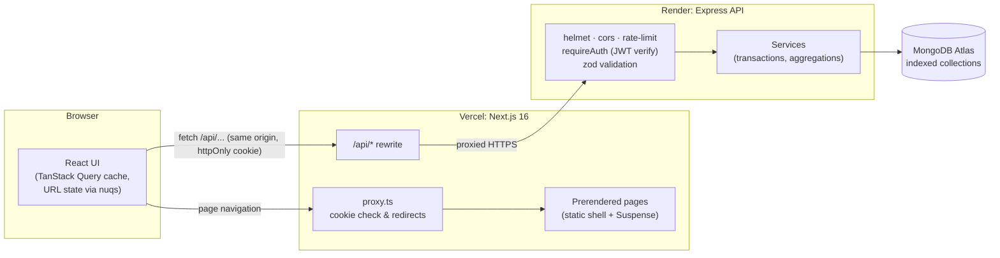

**Request flow**

1. **Page request:** `proxy.ts` runs first. It doesn't call the API; it only checks whether the `dt_token` cookie exists. Visitors without it go to `/login?from=<page>`, and signed-in users who open `/login` go to `/dashboard`.
2. **Page render:** every page is prerendered into a static shell (sidebar, header, skeletons). Parts that depend on the request (URL filters, the current pathname, the `[id]` param) sit behind `<Suspense>` and stream in. The build output marks them `○ Static` / `◐ Partial Prerender`.
3. **Data:** client components call `/api/...` on the same origin. Next.js forwards those requests to Express, and the API verifies the JWT and returns JSON. TanStack Query caches responses by a hierarchical key (`["doctors","list",{...params}]`).
4. **Writes:** a mutation invalidates `doctors`, `patients` and `stats`, so every dependent view (lists, the doctor's count, dashboard charts) refetches. Server validation errors are mapped onto the matching form field.
5. **Expired session:** any `401` triggers `POST /api/auth/logout` to clear the stale cookie (otherwise `proxy.ts` would bounce the user back), then a redirect to `/login?expired=1&from=...`.

**Folder structure**

```
src/
├── app/
│   ├── (auth)/login/           # public route
│   ├── (dashboard)/            # sidebar layout; dashboard, doctors, doctors/[id], patients
│   └── layout.tsx              # fonts, providers
├── components/
│   ├── ui/                     # shadcn primitives (generated)
│   ├── data-table/             # generic DataTable, pagination, search, filters, date range
│   ├── dashboard/ doctors/ patients/ auth/ layout/ shared/
├── hooks/                      # use-doctors, use-patients, use-stats, use-auth, use-table-params
├── lib/
│   ├── api/                    # fetch client, typed endpoints, query-key factory
│   ├── schemas.ts              # zod form schemas
│   └── types.ts constants.ts format.ts form-errors.ts
└── proxy.ts                    # route protection (Next 16's replacement for middleware)
```

## Technical decisions

### 1. Same-origin API proxy with an httpOnly cookie, instead of a token in `localStorage`

The frontend (Vercel) and API (Render) live on different domains. There are three common ways to authenticate across them:

| Option | Problem |
|---|---|
| JWT in `localStorage` + `Authorization` header | Any XSS can read and steal the token, and `proxy.ts` can't see it, so pages can't be protected before they render. |
| httpOnly cookie set directly by `api.onrender.com` | It's a **third-party cookie** on `vercel.app`. Safari blocks it and Chrome is phasing it out, so login fails for some users. It also needs `SameSite=None` and CORS preflight on every request. |
| **httpOnly cookie behind a Next.js rewrite (chosen)** | None of the above. |

`next.config.ts` rewrites `/api/:path*` to the Express server, so the browser only ever talks to its own origin. The API's `Set-Cookie` therefore lands on the frontend's domain as a **first-party, httpOnly, `SameSite=Lax`, `Secure`** cookie:

- JavaScript can't read it, which limits what an XSS bug could steal.
- `SameSite=Lax` blocks CSRF on state-changing requests, with no extra CSRF token needed.
- `proxy.ts` can read it, so unauthenticated users never see a protected page.
- No CORS preflights, and `API_URL` stays server-side, out of the browser bundle.

The trade-off is one extra network hop (browser → Vercel → Render). It's small next to the API's database time and is the price of doing auth correctly. `proxy.ts` deliberately only checks that the cookie exists, following the Next.js guidance that proxy checks should be "optimistic". The API verifies the signature on every request, so a forged cookie gets an empty page plus a redirect, never data.

### 2. TanStack Query + URL state (nuqs) instead of Redux or Context

Almost all state in this app is **server state** (lists, details, stats) or **URL-shaped state** (page, filters, sort). Very little is truly client state.

- **Redux / Zustand** would mean hand-writing loading flags, caching, deduping, invalidation and refetching: a lot of code that TanStack Query already provides.
- **React Context** re-renders every consumer on any change and has no caching or request deduplication.
- **TanStack Query** caches by key, deduplicates identical requests, cancels outdated ones (each request gets an `AbortSignal`), and gives us `placeholderData` so the table never blanks out between pages (previous rows are kept only while paging; a new search or filter shows skeletons, so old results are never mistaken for new ones). Hierarchical keys make invalidation a single line: after adding a patient, `invalidateQueries(["doctors"])` refreshes the doctor list, the detail page's count and its patient list at once. Every view revalidates on mount (`staleTime: 0`), and each page click is exactly one request: no speculative prefetching.
- **nuqs** keeps filters, page and sort in the URL, type-checked by parsers (for example `parseAsStringLiteral(CONDITIONS)` rejects an unknown condition). A filtered view can be shared or bookmarked, survives a refresh, and works with the back button. Because the URL params are the query key, there's a single source of truth and no syncing code.

Re-render control: the search box keeps keystrokes in local state and only updates the URL after typing pauses (300 ms debounce), table columns are memoized, and each list view subscribes only to its own query.

## Visual evidence

| Desktop: Dashboard (light) | Desktop: Dashboard (dark) |
|---|---|
| 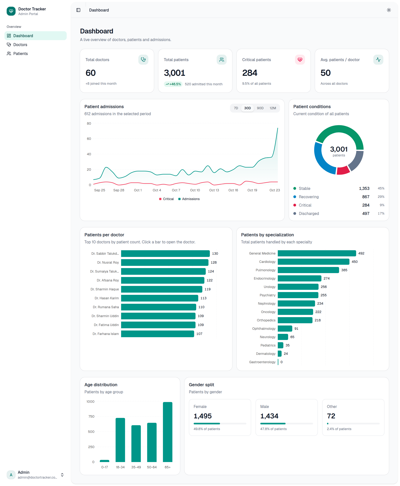 | 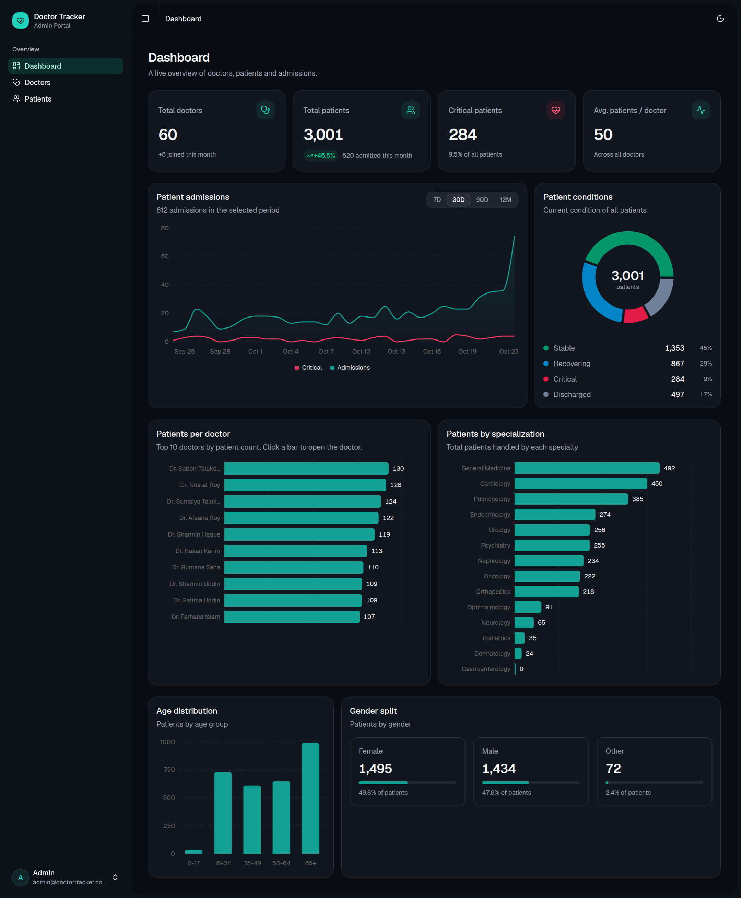 |

| Doctors | Doctor detail |
|---|---|
| 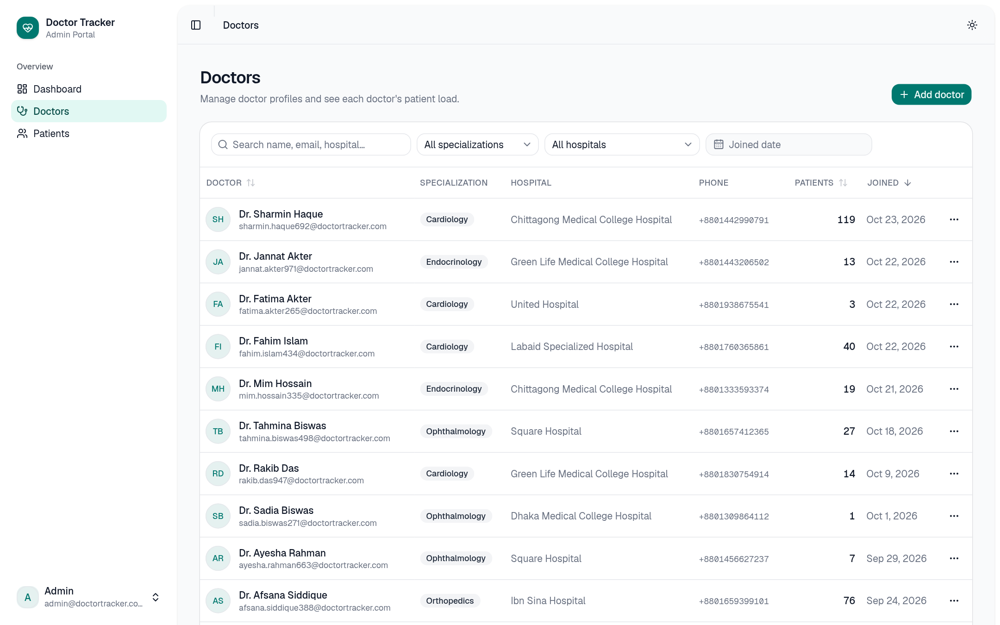 | 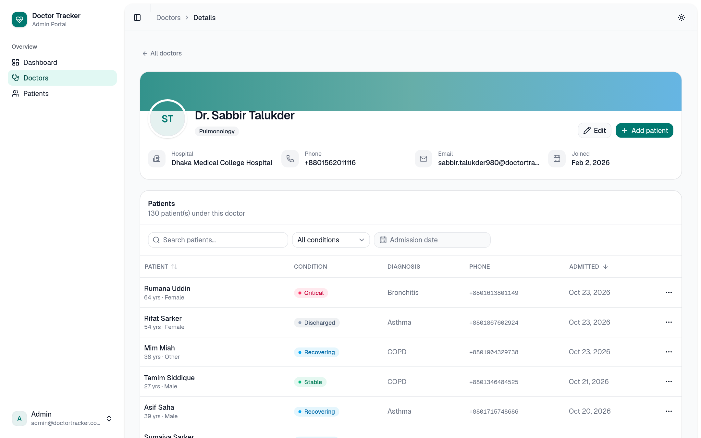 |

| Patients (filtered: Critical) | Form validation |
|---|---|
| 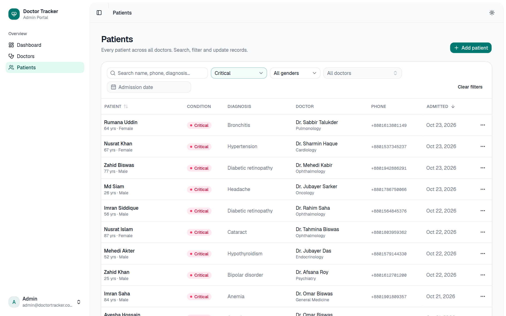 | 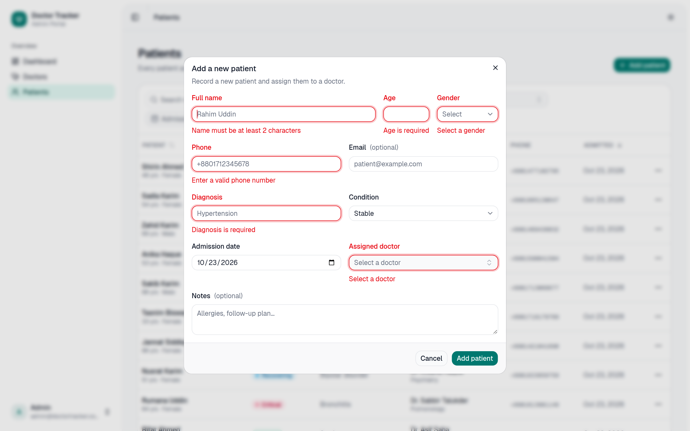 |

| Login |
|---|
| 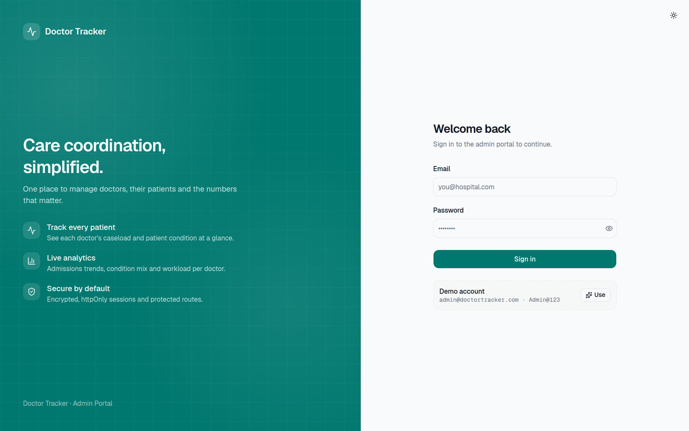 |

**Mobile**

| Login | Dashboard | Doctors | Navigation |
|---|---|---|---|
| 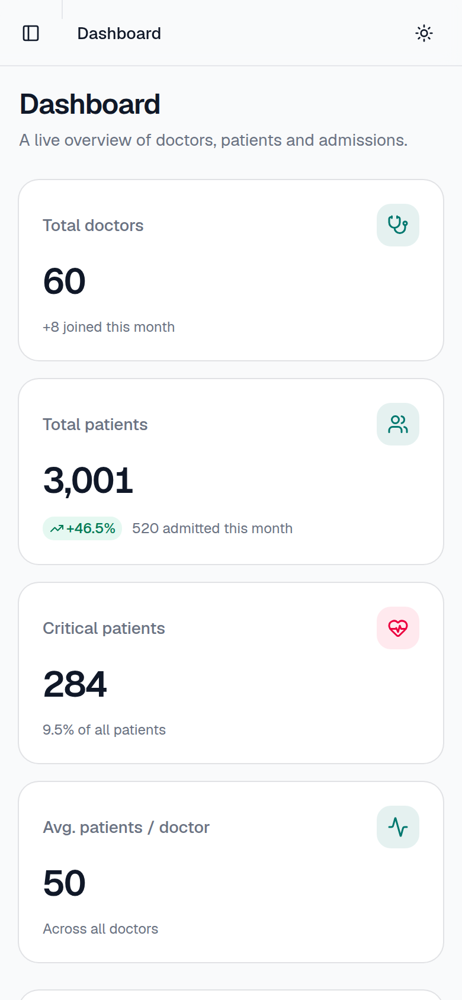 | 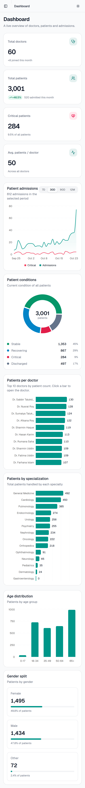 | 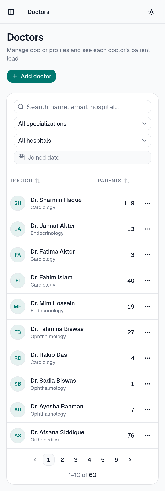 | 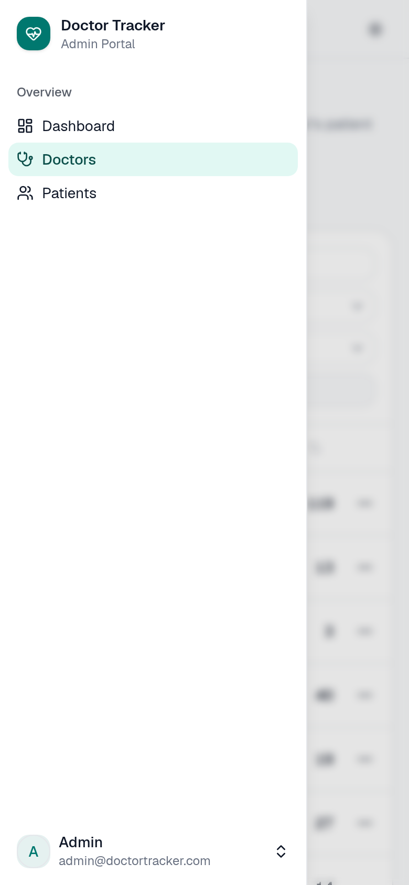 |
